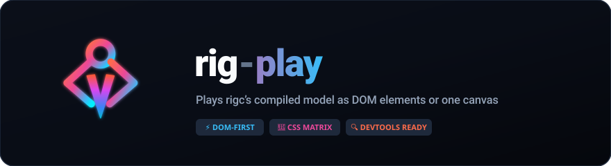

<p align="center">
  
</p>

<p align="center">
  <a href="https://www.npmjs.com/package/spine-html"></a>
  <a href="https://www.npmjs.com/package/spine-html"></a>
  <a href="LICENSE"></a>
</p>

Render [Spine](https://esotericsoftware.com/) skeletal animations as **plain DOM** — one
absolutely-positioned `` per slot, posed with a single CSS `matrix()` write per frame.
No canvas, no WebGL for the rigid tier.

## Why

Every Spine web runtime rasterizes into a canvas. But `spine-core` is fully
renderer-independent: it computes bone world transforms — and even deformed mesh
vertices — on the CPU. For **region attachments** (the rigid parts of a skeleton), a bone
transform is a plain affine map, and CSS `transform: matrix()` expresses that *exactly*.
So the rigid tier of a Spine skeleton can live in the DOM, composited by the browser,
inspectable in devtools, styled with CSS.

The idea has been floated on the official forum three times since 2014 and was never
built — the blockers named were meshes, clipping, and DOM update overhead. This project
is the experiment: how far does the DOM actually go, and how cheap is it?

Measured so far (PoC, Apple silicon — headless and on-device numbers are labeled,
they do **not** substitute for each other):

- Rigid only (spineboy-ess), headless Chromium: 10 skeletons / 180 slot images at
  **~0.03 ms skeleton math + ~0.22 ms DOM writes per frame** — about 1.5% of a
  60 fps frame budget. On-device Safari: 10 rigid skeletons hold **60 fps**.
- With meshes (spineboy-pro), headless Chromium: 1 skeleton = **~0.05 ms + ~0.5 ms
  render** (8 mesh canvases, 323 triangles); 10 running skeletons = **~3.5 ms/frame**
  total, smooth.
- Dirty-skip: 10 *static* skeletons (pose held) = **~0.4 ms/frame** headless and
  **~0.6 ms** on-device Safari — unchanged meshes reuse their raster, so idle or
  held parts cost nothing anywhere.
- Real Safari (on-device), canvas2d mesh backend: in-callback JS stays **~4–5
  ms/frame** for 10 running meshed skeletons — but the rAF rate tells the real
  story: **meshed ×1 = 37 fps, meshed ×10 = 3–4 fps** (rigid-only ×10 = 60 fps).
  The cost lives outside the frame callback, in the compositor/GPU process:
  Safari antialiases canvas2d **clip paths**, so every triangle pays for an AA
  mask. Chromium doesn't antialias clips and stays smooth. This is what the
  optional WebGL mesh backend (below) removes.
- Real Safari (on-device), **webgl mesh backend**: meshed ×1 holds **60 fps**
  (vs 37 on canvas2d), and the meshed ×10 stress scene jumps **3–4 → 45 fps** —
  80 mesh canvases / 3230 triangles redrawn every frame (0 reused, the worst
  case), in-callback JS ~5.8 ms at dpr=1. The per-triangle clip-AA tax is gone;
  the remaining gap to 60 is the blit/compositing cost of a 10-skeleton stress
  scene, not a per-triangle cost.
- Headless-WebKit numbers are a **software rasterizer** and measured up to 28×
  off real Safari in both directions — useful for visual regression only, never
  as Safari perf evidence.

## Status

**Production.** The questions this started as a PoC to answer — how far does the
DOM actually go, and how cheap is it — are answered with on-device numbers: the
practical scenario (a character or two, mostly holding pose, a few parts
deforming) holds **60 fps on every engine measured**, and the 10-skeleton
stress scene holds 45 fps on the weakest one (Safari, webgl backend). Ships
with a self-contained test suite (backend visual parity + invariants) and CI.

- ✅ Region attachments (rigid parts): exact affine mapping, draw-order via `z-index`,
  attachment swaps, alpha
- ✅ Atlas unpacking at load time (90°-packed regions restored to the orientation
  spine-core's UVs name, held by the pixel oracle on exports whose packer rotated),
  so the rigid per-frame path never touches a canvas — a region that covers its whole
  page is passed through uncut, and `revokeRegions()` frees the rest when a skeleton
  is unloaded
- ✅ Mesh attachments (deform tier): small per-part canvases sized to the mesh's world
  bounds, interleaved with the rigid `` slots in one stacking context — the DOM
  handles the bones, a rasterizer handles the warps
- ✅ Blend modes via `mix-blend-mode` (additive = `plus-lighter`)
- ✅ Crack-free mesh seams on clip-antialiasing browsers (Safari): each triangle's
  clip polygon is expanded 0.5px from its centroid so neighbours overlap — the
  texture is continuous across shared edges, so the overlap is invisible
  (`?expand=0` shows the cracks for comparison)
- ✅ RGB tinting (skeleton × slot × attachment color) via an SVG `feColorMatrix`
  reference filter per element — an exact channel multiply that works identically on
  `` and `<canvas>` without touching the raster (needs reference-filter support,
  Safari 15+; verified pixel-level on Chromium and WebKit). Dark/two-color tint is
  not expressible this way and stays out of scope
- ✅ DPR-aware mesh canvas backing store: `renderer.pixelRatio` (defaults to
  `devicePixelRatio`; if you scale the root element, fold that scale in)
- ✅ Dirty-skip: a mesh whose canvas-space vertices didn't change reuses last frame's
  raster — the CSS translate still tracks it, so parts that hold a pose (or move by
  whole pixels) pay zero raster. 10 frozen spineboys: WebKit ~141 → ~0.5 ms/frame
- ✅ Clipping attachments as element-level CSS `clip-path`: spine-core's semantics
  (one active clip at a time, applied from the clip's slot through its end slot
  inclusive), with the polygon expressed in each element's own local frame — the
  inverse of the `` matrix for rigid slots, the canvas translate for mesh
  slots. Covers **part masks** (a clip with a real end slot, like this repository's
  own `portal` animation) and **whole-skeleton clips** (an end slot that never
  arrives, which takes a fast path: one `clip-path` on the root instead of one per
  element). **Inverse clips** are supported too: the region they keep has a hole
  in it, so it needs two rings, and `polygon()` carries only one — a box and a
  polygon listed inside one `polygon()` become a single self-intersecting ring
  whose even-odd fill leaves a wedge along the seam between them (measured, on a
  corner of spineboy's boot). So an inverse clip is written as a two-subpath
  `path(evenodd, …)` whose outer ring is the element's own box. The whole feature
  is element-level, so both mesh backends see the same thing and neither raster
  path knows clipping exists; `renderer.clipping = false`
  restores the old counted-and-skipped behaviour. Concave polygons go to CSS as
  authored — the convex decomposition spine's CPU clipper performs exists to feed a
  triangle rasterizer and has no job here. Two things this does not do: Spine's
  clipper convexifies an *inverse* polygon (convex hull) where CSS clips it as
  authored, so the two agree exactly when that polygon is convex — which is the
  shape `inverse` is meant for; and the cost of many simultaneous `clip-path`s on
  real-device Safari is **not measured** (the headless numbers that exist are not
  Safari evidence — see Measured above)
- ✅ Safari mesh cost root-caused by on-device triangulation (two corrections deep):
  the early "~15× slower per-triangle path" was a **headless-WebKit artifact**
  (software rasterization), and the follow-up "on par with Chromium" held only for
  in-callback JS time. Real-Safari rAF rates — rigid ×10 = 60 fps, meshed ×1 =
  37 fps, meshed ×10 = 3–4 fps with JS flat at ~4–5 ms — put the real cost in the
  GPU process: Safari antialiases canvas2d **clip paths**, so the per-triangle clip
  mapping pays a per-triangle AA-mask tax (the same AA that caused the seam cracks)
- ✅ Optional WebGL blit backend for the mesh tier: `renderer.meshBackend =
  'webgl'` (default stays `'canvas2d'`). All dirty meshes are shelf-packed into
  **one shared offscreen WebGL context** (module-level — browsers cap contexts at
  ~16), drawn as textured triangles with premultiplied alpha, then rect-blitted
  onto the same per-part canvases with an unclipped `drawImage` — cheap on Safari.
  Everything element-level is unchanged: z-index interleave, tint filter,
  `mix-blend-mode`, dirty-skip, grow-only backing. GL rasterizes shared triangle
  edges seamlessly, so this path needs no crack overdraw. Falls back to canvas2d
  when WebGL is unavailable or the context is lost. Backend parity verified by
  headless Chromium+WebKit screenshot diffs (glow / clipping / tint scenes;
  sub-pixel edge differences only). On-device Safari, meshed ×10 with every mesh
  redrawn per frame: **3–4 fps (canvas2d) → 45 fps (webgl)**

## Install

```bash
npm i spine-html
```

The package plays rigs built by [rigc](https://github.com/firejune/rigc):
`rigc build` writes a compiled model document, `skeleton.model.json` (spec
`rigc-compiled/3`), next to the Spine pair and the atlas pages. That document
is what the player loads, and it states everything posing and drawing need —
the skeleton, the animations, and where every region sits on its page — so the
`.atlas` and `skeleton.json` beside it are not fetched. Poses are computed by
`rig-c/core`, rigc's own posing core, which is bundled into this package: there
is nothing else to install.

```ts
import { loadModel, RigPlayer } from 'spine-html';

const assets = await loadModel({ modelUrl: '/rigs/walk/skeleton.model.json' });

// A positioned element becomes the rig's world origin (Y-up: the rig grows
// upward from it). Layout and scaling are the caller's.
const player = new RigPlayer(rootElement, assets);
player.play('walk');                        // looping; { loop: false } holds at the end

function frame(delta: number) {
  player.frame(delta);                      // step the track by delta × timeScale, draw
}

// Unloading (a cutscene ends, a level swaps): elements first, bitmaps second.
// The unpacked regions are blob URLs — nothing else frees them.
player.dispose();
assets.dispose();
```

The player owns one track: `play(name, { loop })` opens an animation at its first
pose, `frame(dt)` steps it (or `advance(dt)` then `draw()`, to time the two
apart), `pause()` / `resume()` hold and release it, `timeScale` scales every
step, and `seek(t)` moves it to a time. A seek is "reopen, then step to the
time" in `seekStep` increments (1/60 s by default) — never a jump, because a
physics rig has history and its pose at a time depends on the steps that
reached it. `on('event', …)` receives the event keys each step crosses, in the
runtime's order across a loop's wrap; `on('complete', …)` fires once a step
completes a cycle. `skin` (a constructor option) poses under a named skin;
without it the rig is posed the way a fresh Spine skeleton is, with no skin
set. `player.color` multiplies a whole-rig colour into every slot's tint.
`player.renderer` is the `DomRenderer` underneath, whose knobs and counters
are below.

**What it refuses, by name.** A Spine export (`.json`, `.skel`) is refused
before anything is fetched: this package reads compiled models and nothing
else. A document whose `spec` is not one `rig-c/core` reads is refused with the
core's own sentence plus "build it with `rigc build`", and so is a
`rigc-compiled/1` document, which predates the `pages` section.

`spine-html` is a third-party renderer and is not affiliated with or endorsed by
Esoteric Software.

### Drawing your own frames

`RigPlayer` is the convenient path; the renderer underneath takes a plain
record, so anything that can produce one can draw through it:

```ts
import { DomRenderer, type PosedFrame } from 'spine-html';

const renderer = new DomRenderer(rootElement, assets.regionImages, assets.pageImages);
renderer.render(frame); // frame: PosedFrame
```

```ts
PosedFrame { order: PosedSlot[] }                     // the slots that draw, in draw order
PosedSlot = { slot; z; blend: 'Normal'|'Additive'|'Multiply'|'Screen';
              tint: [r, g, b, a]; dark?: [r, g, b];
              clip?: { polygon: number[]; inverse: boolean } }   // world space, Y up
          & ( { kind: 'region'; region: string; corners: number[] /* BL, UL, UR, BR */ }
            | { kind: 'mesh'; page: string; pma: boolean; vertices: number[];
                uvs: number[]; triangles: number[]; sequence: number } )
```

`player.posedFrame()` returns the record the player would draw. Two things the
renderer reads off it by identity rather than by value: every slot a clip
covers carries the **same** `clip` object (one that covers every slot of the
frame takes the one-`clip-path`-on-the-root path), and a mesh's `uvs` and
`triangles` are the same arrays from frame to frame for the same texture
mapping (a new array re-rasters the mesh).

### One load, several players

One `loadModel` backs any number of players: the regions are cut once, and
every player draws from the one `regionImages` map. A player owns none of it —
disposing a player leaves the bitmaps alive for the others — so there is exactly
one `assets.dispose()`, after the last player is gone:

```ts
const assets = await loadModel({ modelUrl: '/rigs/walk/skeleton.model.json' });
const a = new RigPlayer(rootA, assets);
const b = new RigPlayer(rootB, assets, { skin: 'winter' });

a.dispose();
b.dispose();
assets.dispose();
```

A document is one rig. Two rigs whose builds share page images load as two
documents; the images are fetched by URL, so a page both name at the same URL
is loaded once by the browser — but each load cuts its own regions and owns its
own blob URLs.

### Loading it yourself

`loadModel` is a convenience over two calls the package exports: read the
document, load its pages, and cut the regions with `unpackRegions`, which takes
the document's `pages` section — `{ name, width, height, pma, regions: [{ name,
x, y, width, height, degrees }] }` per page — and a map of page images keyed by
those names. Use it when the page images do not come from a URL (`resolvePage`
on `loadModel` covers the ones that come from another URL), and pair it with
`revokeRegions` on unload.

A region the packer stored turned (`degrees: 90`) is cut upright again, and
which way round that is comes from the UVs a runtime assigns such a region,
not from the cut: its corners carry `(u2, v2), (u, v2), (u, v), (u2, v)` in the
order BL, UL, UR, BR, so the artwork's top-left corner sits at the packed rect's
bottom-left and unpacking it is a clockwise turn. Every release up to 0.7.0
turned it the other way and drew rotated rigid parts 180° round (#49).

`unpackRegions` mints one blob URL per region; `revokeRegions` is its
counterpart. It only frees URLs `unpackRegions` created, so a map you built
yourself and page images reused by the whole-page pass-through survive it — and
calling it twice is a no-op. Load once for the page's lifetime and you can
ignore it; load and unload repeatedly without it and you leak an atlas per
cycle.

### Pages that ship at another resolution

A page image may ship at a resolution its document does not declare — a
half-resolution texture build, or an @2x variant, with the page's `width` and
`height` left as the build wrote them. Nothing here needs a flag for that. A
region's bounds are read **relative to the declared page size** and scaled onto
the image's natural size, which is how the page UVs the mesh tier samples with
are derived too (`u = x / page.width`), so both tiers land on the same pixels at
any resolution.

Each unpacked bitmap comes out at the **native resolution of the pixels it was
cut from** — half-resolution pages cost a quarter of the cut pixels, and
nothing is upscaled back — while `RegionImage.width`/`height` stay in **atlas
units**. Those two numbers are the `` layout box and the denominator of
its CSS matrix, so the rig poses identically and the browser scales the
smaller bitmap into the same box, the way a GPU samples a smaller texture
through the same UVs. Ship one build and swap the images per device if you
like (`resolvePage`).

### Premultiplied pages (`pma`)

A page's `pma` flag in the document's `pages` section — the build copies it from
the atlas's `pma: true` line — says its RGB is already multiplied by its alpha,
and nothing is asked of you: each tier is handed the page in the convention it
actually consumes. The `webgl` mesh backend uploads the texels unconverted (its
blend already expects premultiplied source — lossless). The DOM and canvas2d
tiers cannot: an `` and `drawImage` composite straight alpha by definition,
so they read a straight-alpha derivation of the page —
`rgb = round(rgb * 255 / a)`, computed once and shared by the region cuts and
the mesh raster. Without it every semi-transparent texel is multiplied by its
alpha a second time and draws darker than it was authored: soft edges, soft
shadows, glows.

What it costs: **one page-sized canvas per premultiplied page image**
(width × height × 4 bytes — 1 MiB for a 1024×256 page, 16 MiB for a 2048×2048
one), alive as long as the page image is and released with it; the cache is
weak, so there is nothing to free by hand. A page without the flag derives
nothing. The division is 8-bit and starts from a canvas read, which has itself
quantized a premultiplied texel, so a very transparent texel can land a few
levels off — exact at alpha 0 and 255, within one level of 255 above alpha 128,
and a little more below that, by an amount that belongs to the browser's canvas
rather than to this package. It is invisible wherever the texel is: a texel at
alpha 11 is ~4% opaque. The `webgl` backend, having no such step, is exact.

One consequence worth knowing if your build is one part per page: a whole-page
region on a premultiplied page is **cut** rather than handed through, because
the page's own URL holds premultiplied pixels (see below).

### What unloading frees

`revokeRegions()` — and `assets.dispose()`, which calls it — frees the blob URLs
`unpackRegions` minted, and nothing else. The page images are held by
`assets.pageImages` and by every player drawing from them, so a page is
released once you drop the assets and every player is disposed. With the
`webgl` mesh backend the shared blitter also uploads each page image on first
use, but that GL texture is not the module's forever: every renderer drawing
the page holds a reference to it, `player.dispose()` hands those back, and the
texture is deleted once the last renderer using that page is disposed — a later
frame that needs the page uploads it again. The cache is keyed weakly by the
page image, so a renderer dropped without `dispose()` costs GPU memory until
the context is lost, but never keeps the image itself alive.

A rig with meshes samples its page bitmaps every frame, so their decoded form
stays in use: a floor on the order of `page width × page height × 4` bytes per
page. A rigid-only rig draws nothing from the pages after `unpackRegions`, and
what a merely reachable, undrawn image costs is up to the browser, not
measurable from script.

Unload in this order:

1. `player.dispose()`, for every player using the assets.
2. `assets.dispose()` (or `revokeRegions(regionImages)`).
3. Drop your references to the assets.

### One part per page

`rigc build` writes one page per part by default — each part PNG is its own
page, its one region covering it — and `rigc build --pack` arranges the parts
onto shared pages instead. Both play here, unchanged:

- Regions that cover their whole page are handed straight through by
  `unpackRegions` instead of being cut and re-encoded — at any image resolution,
  since covering the page is a statement about the declared size. Load cost for
  this shape is just the image loads. The exception is a page marked `pma`: its
  URL holds premultiplied pixels, which an `` would composite as straight
  alpha, so those regions are cut from the straight-alpha derivation like any
  other (and the blob is revoked by `revokeRegions` like any other).
- A packed build cuts every region from its page once, at load, and its meshes
  sample the shared page through page UVs.

### Runtime knobs and what they cost

- `renderer.pixelRatio` — mesh-canvas backing pixels per CSS pixel (defaults to
  `devicePixelRatio`; if you scale the root element, fold that scale in so the
  raster matches the screen: `devicePixelRatio * rootScale`). **Writing it
  reallocates every mesh canvas backing store on the next frame**, and each
  reallocation recreates a GPU surface — the cost that took real Safari to ~3 fps
  when it happened per frame. Each canvas is then sized from what the new ratio
  needs, in both directions: lowering the ratio gives the backing pixels back
  (the backing is grow-only *within* a ratio, not across a change of one). Set
  it when a layout settles, never per frame:
  debounce resize drags and quantize the value instead of tracking it
  continuously. `renderer.canvasReallocCount` is the check — it must fall back to
  zero within a second or two.
- `renderer.syncPixelRatio()` — measures the root's effective on-screen scale
  and sets `pixelRatio` to `devicePixelRatio × scale`, returning the ratio now
  in effect. It appends a hidden 100 px box to the root, reads its box once and
  removes it (the root itself is usually 0×0), so it is **one forced layout per
  call** — which is exactly why the renderer never calls it for you: there is no
  per-frame layout read anywhere in this library. Call it when a zoom or a
  layout *settles* (gesture end, debounced resize), not during the drag. A
  change under 0.1% is ignored, so layout jitter cannot churn GPU surfaces, and
  a root that is not laid out (a `display: none` ancestor) leaves the ratio
  alone. Under an ancestor rotation the measured box is inflated and the ratio
  errs high — oversampling costs pixels, undersampling costs picture.
- `renderer.meshBackingPixels` — allocated mesh-canvas backing pixels
  (Σ width × height), computed on demand. This is what `pixelRatio` moves
  quadratically, and the cheapest way to see an oversampling stage; the demo
  prints it in the stats line as `backing N Mpx`.
- `renderer.meshBackend` — `'canvas2d'` (default) or `'webgl'`; same output, but
  heavy deforming scenes on Safari want `'webgl'` (see Measured above). Falls back
  to canvas2d automatically when WebGL is unavailable. Switching re-rasters every
  mesh once (no reallocation), so it is fine to expose as a user setting.
- `renderer.triangleExpand` — clip overdraw in px that closes antialiased mesh
  seams (default 0.5). Also re-rasters every mesh once when changed.
- `renderer.clipping` — apply the clips the frame carries (default `true`).
  Which slots a clip covers is decided where the frame is made — the player's
  adapter walks the draw order the way the runtime's draw loop does (one clip in
  force at a time, a second one met while one is in force ignored, the end slot
  inside its own clip). What the renderer writes is one CSS `clip-path` per
  element a clip covers, in that
  element's own local frame; nothing reaches the raster backends, and a clip is
  not part of the mesh dirty signature, so a mesh that held still keeps reusing
  its raster under a moving clip. **Writes happen on change only**: each
  clip-path is cached exactly as `transform` is, coordinates are quantized to
  1/1000 of a local unit so float jitter cannot defeat that cache, and a static
  polygon over a static pose therefore costs **zero style writes per frame after
  the first** — `renderer.clipWriteCount` is the check, alongside
  `clipCount` (clips applied) and `clipSkipCount` (clips in the frame not
  applied: switched off, or a degenerate polygon; a clip the runtime itself
  ignores never reaches the frame). **The whole-skeleton fast path**: when one
  clip covers every slot of the frame, one `clip-path` goes on the root instead
  of one per element. The root is *your* element, so its inline `clip-path` is **borrowed,
  not taken** — saved on the first write and put back verbatim when the clip
  stops covering the frame, when `clipping` goes `false`, and by `dispose()`.
  Per-element clip-paths and the root clip-path are never both in force for the
  same clip. Two things to know about that path: the polygon is written in the
  root's **border box** frame, which is where absolutely-positioned slot elements
  start too *unless the root has a CSS border* (a border would offset the
  whole-skeleton clip by its width — keep borders off the render root, which is
  the normal shape for a 0×0 origin element); and an inverse clip never takes it,
  because its CSS form needs an outer ring around a box and the root has none.
  One further consequence of that path: a `clip-path` other than `none` makes an
  element a stacking context (CSS Masking), so a whole-skeleton clip isolates
  `mix-blend-mode` slots from backdrops *outside* the root — which a root
  carrying a `transform` (the usual pan/zoom stage) already does. Per-element
  clips do not change blending, since a blended slot is its own stacking context
  either way. Setting `clipping = false` removes every clip-path this renderer
  wrote.

**A zoomable stage.** The mesh tier rasters at `world × pixelRatio` in the
root's own coordinates, and it cannot see a CSS transform above the root — so
the most natural pan/zoom stage, `transform: scale(zoom)` on an ancestor, makes
it oversample by `1/zoom²` in backing pixels until the zoom is folded in. The
picture stays correct throughout, which is what makes this easy to ship: only
the allocation and the frame rate move. Call `syncPixelRatio()` when the zoom
settles, or set `pixelRatio = devicePixelRatio * zoom` yourself. Measured
on-device (Chromium, dpr 2, stage under `scale(0.25)`, ~2.2 M CSS px on screen):

| scene | `pixelRatio` | `meshBackingPixels` | fps |
| --- | --- | --- | --- |
| 57 meshes | `devicePixelRatio` (2) | 139.1 Mpx | 14–21 |
| 57 meshes | `dpr × zoom` (0.5) | 9.1 Mpx | 61 |
| 92 meshes | `devicePixelRatio` (2) | 141.1 Mpx | 36–39 |
| 92 meshes | `dpr × zoom` (0.5) | 9.1 Mpx | 60–61 |

## Demo (this repository)

```bash
bun install
bun run dev
```

The demo plays rigc's own gallery rigs (`walk`, `flex`, `squash`, `portrait`,
`nod`, `look`, `ride`), each built by `rigc build` from a pinned rigc tag into
`public/rigs/<name>/` on first `dev`/`build` — and each again with `--pack` into
`public/rigs/<name>-packed/`. The same step downloads the official spineboy
example assets, which the test suite's reference side reads (they are owned by
Esoteric Software and not redistributed in this repository — see
[NOTICE.md](NOTICE.md)); `bun run fetch-assets` runs it manually, and it is
idempotent.

Debug knobs (query string): `?rig=flex` `?anim=wave` `?count=10` pick the scene,
`?tint=ff8080` tints the whole rig, `?dpr=2` overrides the mesh-canvas backing
ratio, `?timescale=0` freezes the pose (every mesh should report "reused"),
`?expand=0` disables the crack-closing clip overdraw, `?backend=webgl` rasterizes
meshes through the shared WebGL blitter (also a live header select; the stats line
names the active backend), `?clipping=0` turns clips back off (they are then
counted and skipped), and `?time=1.2` seeks every instance to the same pose for
deterministic captures.

## Tests

```bash
bun run test   # builds + serves the demo, then runs chromium + webkit
```

Playwright drives the demo (`tests/`, config in `playwright.config.ts`; CI
runs the same suite on ubuntu). Two stages carry the same frame loop and stats
line: the demo, over the gallery builds and the model path, and
`tests/spine-stage.html`, over spineboy posed by spine-core and read into the
same frame record by the test suite (`tests/skeletonFrame.ts`) — that is where
the additive-blend and clipping scenes live, which no gallery build carries.
spine-core (4.3) is a devDependency for that reference side only; nothing the
package ships names it. The visual check is
**A/B within one run**:
no golden snapshots are committed (they rot across platforms/GPUs) — instead
the same deterministic pose (`?time` + `?timescale=0`) is screenshotted with
`?backend=canvas2d` and `?backend=webgl` in the same engine and the buffers
are diffed directly with a shift-tolerant comparison, so missing parts,
wrong colors, and tint/blend divergence fail regardless of platform.
Hairline seams are guarded by a deterministic canary (`?expand=0` must
change the canvas2d raster), and counter tests pin the dirty-skip /
grow-only-backing / clip-counter invariants plus spine-core's region corner
order (BL, UL, UR, BR).

**The frame gate** (`tests/frames.spec.ts`, node-side) is what the model path
rests on. Every gallery build is posed twice from the two pairs of files the
build wrote — the Spine pair by spine-core 4.3 on rigc's render recipe, the
model pair by `rig-c/core`'s live track through the package's own adapter —
and the two frames are compared field by field at **tolerance 0**: draw order,
every region's corners and page UVs, every mesh's vertices, page UVs and
triangles, tint, blend, clip. Every animation, `dt = 1/12`, through the loop's
wrap; one page per part and packed. The run prints the counts it compared.

Clipping gets its own oracle (`tests/clipping.spec.ts`), because a clip-path
that went through the wrong transform still parses and still counts as applied.
A clipped capture is compared against the **unclipped** capture of the same
slots masked in **screen space** by the world polygon — built once through the
stage transform, never through an element's local frame, so the check cannot
agree with the renderer by sharing its mistake. What it asserts is occupancy,
not pixel values: outside a 3 px band around the polygon's outline (where the
browser's clip-path antialiasing and the canvas `ctx.clip()` the oracle uses
legitimately differ), **no artwork may survive where the polygon excludes it
and none may go missing where it does not** — both counts absolute, no budget.
Pixel values are logged but not asserted, because a clipped element is drawn
through a mask and its silhouettes come out a shade different all over the
picture; a control capture, clipped by a polygon that removes nothing, pins
that down by coming back byte-identical to the unclipped one.

The loading path is not observable in a rendered frame, so it gets its own
page (`tests/harness.html`, a second build entry) that exposes the library to
the specs directly. Its oracle is the browser: a revoked object URL stops
resolving, so blob ownership — every unpacked URL freed, nothing the caller
owns touched, nothing stranded by a failed load — is asserted rather than
assumed.

### The pixel oracle: a reference that is not us

Everything above compares this package against itself. That catches one mesh
backend drifting from the other and, by construction, cannot catch a defect
they **share** — which is what happened with `pma: true` pages, drawn one
multiply too dark in every tier while the suite stayed green for months.

So `tests/oracle.spec.ts` compares against the official runtime. The same
export, the same frozen pose, the same size, the same atlas page, drawn by
`@esotericsoftware/spine-webgl` into a canvas whose orthographic camera is
solved to land world space on exactly the pixels the DOM stage lands it on —
then both are screenshotted and diffed. Thirteen spineboy cells: the rigid tier,
the mesh tier on both backends, the exporter's own premultiplied page
(`spineboy-pma`) on all three, a clipping pose, an additive-blend pose on both
backends, a mesh-deform pose on both backends, a per-slot rgba/alpha pose, and a
whole-skeleton tint — the renderer under a spine-core pose. And twelve gallery
cells, which are the package end to end: the DOM side loads the build's
`skeleton.model.json` and plays it with `RigPlayer`, posed by `rig-c/core`; the
reference draws the `skeleton.json` and atlas the same build wrote, posed by
spine-core.

It earned its keep on the first run: the rigid tier was drawing every
90°-packed atlas region 180° round (#49), in every release up to 0.7.0, and no
comparison of this package against itself could have seen it. The cut's own
guard (`tests/regions.spec.ts`) asserts a rotated cut's pixels against the page
texels its UVs name, independently of any rendered pose; each oracle cell logs
how many regions its atlas rotated.

Two things make it evidence rather than decoration. The camera match is
**derived** — solved against the DOM mapping, not fitted to a picture — and
then **proved by driving it**: a deliberate one-world-unit offset of one side
must change the diff, which it does by 3.3× and 6.5×. And what is forgiven is
antialiasing and texture filtering and nothing else, so the stage sits where
one atlas texel is one CSS pixel and neither runtime resamples. Limits are
ratios of drawn content, plus a darker-minus-lighter excess on the
premultiplied cells, because that defect class can only go one way — never an
absolute per-pixel precision number, which is a platform's number and not a
package's.

spine-webgl is a **development dependency**. It is named by one file under
`tests/`, it is in neither `dependencies` nor `peerDependencies`, and
`tests/package.spec.ts` asserts that nothing the published package contains so
much as mentions it.

## Benchmark: side by side with the official runtime

```bash
bun run bench:dev     # the page, for a person to watch (and for Safari)
bun run bench         # drives it in a headed Chromium and writes a report
```

`bench/` is a separate vite project — not part of the library, and not part of
what `bun run build` emits — that runs the same skeleton in both runtimes side
by side, each with its own stats line in the demo's style. Scenes by query
string: `?scene=mesh` (the deform tier working every frame), `?scene=held` (a
frozen pose, where unchanged meshes reuse their raster and the reference
redraws regardless), `?scene=rigid`, and `?scene=many&count=N` independent
players. All four take `&count=N` up to 64 (a page limit, so that a cell stays
something you can see), laid out on one grid whose per-rig scale shrinks with
the column count, so a step up in count adds rigs rather than cropping the ones
already there.

**The two sides draw the same picture, and each draws it the way its own
runtime is written.** Those are separate rules and the first runs of this page
broke both:

- **One grid, one clip.** A rig is clipped to exactly the rect the reference's
  canvas covers for it — `overflow: hidden` on a box, the way a page embeds a
  player. Without it the DOM rigs composite over their neighbours while the
  reference's viewport discards the same pixels for free, so the two sides
  aren't showing the same picture and the DOM side is carrying layers the
  reference never pays for. Placement is derived once and read by both sides,
  and then *checked*: each side reports `origin Δpx`, the largest gap between
  where the grid puts a rig and where that side drew it, and the report table
  carries it per row. (`contain: layout paint` is deliberately not used: paint
  containment clips to the same edge `overflow: hidden` does, and what it adds
  past the clip — a stacking context, a containing block, an independent
  formatting context — changes how one side is composited and buys the
  comparison nothing. Skipping work outside the box is `content-visibility`,
  not containment.)
- **The reference gets its own architecture.** For a grid of rigs it draws into
  **one** canvas through one batched `SceneRenderer`, which is how a spine-webgl
  application is written and is its home ground; 64 rigs leave as a handful of
  draw calls. One WebGL context per player is right only for `?scene=many`,
  which is *about* the browser's ~16-context cap — the page counts the contexts
  it was refused and the ones the browser took back, says so in the header, and
  keeps going rather than dying at the cap. Each stats line names which shape it
  is in: `shared canvas` or `context per player`, with the alive count.

`scripts/bench.mjs` walks `bench/scenes.json`, opens each scene in a **headed**
Chromium (a hidden page throttles `requestAnimationFrame`, so a headless
reading would be the browser's power policy rather than either runtime's cost),
runs a fixed number of frames per runtime — one at a time, because rAF has a
single cadence per document — and writes JSON plus a markdown table with the
conditions attached: browser version, device pixel ratio, window size, GPU
string, and the load average before and after. Over a threshold it stamps the
whole report `INVALID: load average too high` and exits non-zero, because a
benchmark on a busy machine measures the machine. `--corpus <dir>` points it at
local rigs that never enter this repository.

> **Numbers pending.** No comparison table is published yet. The instrument is
> fair in both directions now and its scenes step far enough to leave a desktop
> GPU's vsync ceiling, but a reading taken on a loaded machine, a CI runner or
> a headless browser would not be worth printing — and every reading taken
> while the instrument was being repaired has been discarded rather than
> quoted. The table will be taken the way every other number in this README
> was: the two stats lines read on a real device, on a quiet machine, per scene
> and per engine — including Safari, which stays manual because no automation
> preserves what is being measured there. Until then the instrument exists and
> the measurement does not.

The server is part of the test: a run tests whatever is being served on its
port. Two checkouts of this repository on one machine (a worktree, a second
clone) default to the same port 4321 and reuse an existing server, so the
second run quietly tests the first one's build — green, and about the wrong
tree. Give each concurrent checkout its own port with `TEST_PORT`
(`TEST_PORT=4333 bun run test`); setting it also disables server reuse, so a
busy port fails the run instead of being borrowed. Unset, nothing changes:
port 4321, reuse unless `CI`.

Standing rule: **headless numbers are never Safari performance evidence** —
nothing in the suite asserts timing, and headless-WebKit fps/ms readings do
not transfer (software rasterizer, measured up to 28× off real Safari). The
perf oracle is the demo's stats line on a real device.

## How it works

1. `loadModel` reads the rig's compiled model document (`rig-c/core`'s `readModel`),
   and `RigPlayer` opens an animation on a live track (`openTrack`): bones,
   constraints, physics, deform and draw order are posed by the core — all
   CPU-side, renderer-agnostic — one `dt` at a time.
2. At load time each region of the document's `pages` section is cut into its own
   bitmap (rotation restored), one blob URL per region — except regions that already
   cover their whole page, which are used as they are.
3. Per frame, the pose becomes a `PosedFrame`: for each slot in draw order, a region's
   four world corners (order **BL, UL, UR, BR**) or a mesh's world vertices, page UVs
   and triangles, its tint, blend and clip. For a region: flip Y (the frame is Y-up),
   derive the affine from three corners, write one `matrix()` string. That's the
   whole rigid render path.

## License

The code in this repository is MIT licensed.

It depends on the [Spine Runtimes](https://github.com/EsotericSoftware/spine-runtimes)
(`@esotericsoftware/spine-core`), which are licensed under the
[Spine Runtimes License](https://esotericsoftware.com/spine-runtimes-license):
**integrating the Spine Runtimes — including through this project — requires each user
to have their own valid Spine Editor license.** See [NOTICE.md](NOTICE.md).

Example assets (spineboy) are owned by Esoteric Software and are fetched from the
official repository at setup time, not redistributed here.
